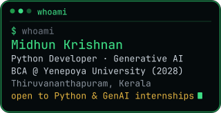
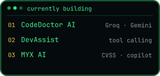
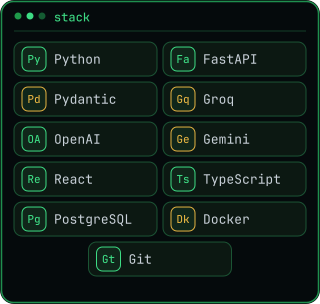
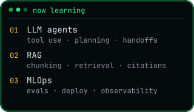

<div align="center">

<a href="https://github.com/midhunkrishnan-131">

</a>
<a href="https://www.linkedin.com/in/midhun-krishnan-342084436/">

</a>
<a href="https://github.com/midhunkrishnan-131">

</a>
<a href="mailto:midhunmaddy84@gmail.com">

</a>


<!--
  Side cards are self-hosted SVGs in assets/ (scripts/generate_cards.py).
  Stats: github-stats-extended (maintained, API-compatible successor of
  github-readme-stats — the public vercel.app deployment is paused).
  Streak: streak-stats.demolab.com.
  Snake: .github/workflows/snake.yml writes the SVG to the output branch.
-->

<table>
<tr>
<td width="30%" align="center" valign="top">

<br/><br/>

<br/><br/>

<br/><br/>

</td>
<td width="40%" align="center" valign="top">

</td>
<td width="30%" align="center" valign="top">

<br/><br/>

<br/><br/>

</td>
</tr>
</table>


</div>

## >_ whoami

```
Midhun Krishnan B
Python Developer · Generative AI Engineer
GenStack @ Black Box Learning
```

- **BCA (Computer Science)** — Yenepoya University *(expected 2028)*
- **Location:** Thiruvananthapuram, Kerala, India
- **Focus:** LLM API integration (Groq, OpenAI, Gemini), structured outputs, tool calling, and resilient REST clients
- **Experience:** Ex-IT Support @ ICICI Prudential Life Insurance
- **Status:** Open to **Python Developer** and **Generative AI** internships

## >_ featured projects

<table>
<tr>
<td width="50%" valign="top">
<strong><a href="https://github.com/midhunkrishnan-131/CodeDoctor--AI">CodeDoctor AI</a></strong>
<br/><br/>
AI debugging lab: Monaco editor, sandboxed Python runner, and Groq/Gemini diagnosis in full-fix or Socratic mode.
<br/><br/>
<a href="https://github.com/midhunkrishnan-131/CodeDoctor--AI"></a>
</td>
<td width="50%" valign="top">
<strong><a href="https://github.com/midhunkrishnan-131/LLM-cli-client">DevAssist</a></strong>
<br/><br/>
Engineering CLI for multi-turn LLM chat, streaming, strict JSON, and a validated tool-calling loop.
<br/><br/>
<a href="https://github.com/midhunkrishnan-131/LLM-cli-client"></a>
</td>
</tr>
<tr>
<td width="50%" valign="top">
<strong><a href="https://github.com/midhunkrishnan-131/api-client-project">Production-Grade API Client</a></strong>
<br/><br/>
Reusable HTTP client with session reuse, retries, exponential backoff, and pagination.
<br/><br/>
<a href="https://github.com/midhunkrishnan-131/api-client-project"></a>
</td>
<td width="50%" valign="top">
<strong><a href="https://github.com/midhunkrishnan-131/myx-ai-windows">MYX AI</a></strong>
<br/><br/>
Windows security-assessment workspace. Discover, detect, defend: evidence-backed findings, CVSS, and an analyst copilot.
<br/><br/>
<a href="https://github.com/midhunkrishnan-131/myx-ai-windows"></a>
</td>
</tr>
</table>

## >_ stack

<div align="center">


<br/>


</div>

## >_ contact

- LinkedIn — [midhun-krishnan](https://www.linkedin.com/in/midhun-krishnan-342084436/)
- GitHub — [midhunkrishnan-131](https://github.com/midhunkrishnan-131)
- Email — [midhunmaddy84@gmail.com](mailto:midhunmaddy84@gmail.com)
