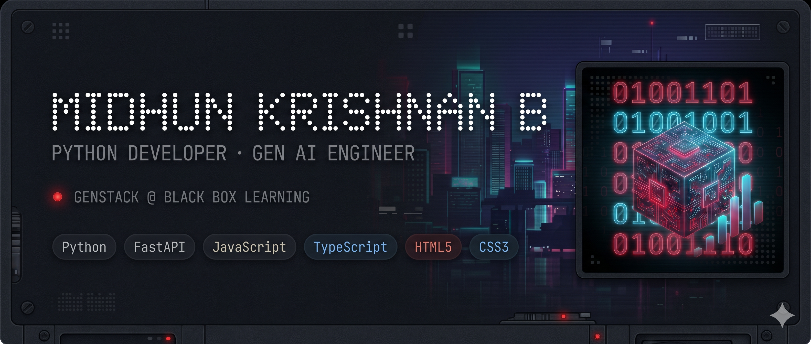

>_ MIDHUN-KRISHNAN-131 // ABOUT ME

<table>
<tr>
<td width="62%" valign="top">
<pre><code>&gt;_ WHOAMI
Midhun Krishnan B
Python Developer · Gen AI Engineer
🔴 GenStack @ Black Box Learning</code></pre>
<ul>
<li>🎓 <strong>BCA (Computer Science)</strong> — Yenepoya (Deemed to be University) <em>(Expected 2028)</em></li>
<li>📍 <strong>Location:</strong> Thiruvananthapuram, Kerala, India</li>
<li>🤖 <strong>Focus:</strong> LLM API integration (Groq, OpenAI, Gemini), structured outputs, tool calling, and resilient REST API clients</li>
<li>🛠️ <strong>Experience:</strong> Former IT / Technical Support at ICICI Prudential Life Insurance</li>
<li>⚡ <strong>Status:</strong> Open to <strong>Python Developer</strong> &amp; <strong>Generative AI</strong> Internships</li>
</ul>
</td>
<td width="38%" valign="top" align="center">
<pre><code>&gt;_ 8-BIT_ASCII // MIDHUN
01001101  [M]
01001001  [I]
01000100  [D]
01001000  [H]
01010101  [U]
01001110  [N]
─────────────
SYS_STATUS: ONLINE 🔴</code></pre>
</td>
</tr>
</table>

>_ PROJECTS // BENTO GRID

<table>
<tr>
<td width="33%" valign="top">
<h3>🔴 <a href="https://github.com/midhunkrishnan-131/CodeDoctor--AI">CodeDoctor AI</a></h3>

AI-assisted Python coding &amp; debugging platform with complete-answer and Socratic logic-hint modes, isolated execution, anomaly detection, SQLite history, and Groq/Gemini fallback.

</td>
<td width="33%" valign="top">
<h3>🔴 <a href="https://github.com/midhunkrishnan-131/LLM-cli-client">DevAssist CLI</a></h3>

Engineering-focused CLI LLM client featuring multi-turn streaming, provider token/cost tracking, 429/5xx retry rules, strict JSON-schema invoice extraction, and calculator tool calling.

</td>
<td width="33%" valign="top">
<h3>🔴 <a href="https://github.com/midhunkrishnan-131/api-client-project">API Client</a></h3>

Production-grade reusable REST client with session reuse, exponential backoff with jitter, <code>Retry-After</code> support, fail-fast 4xx checks, structured logging, and generator pagination.

</td>
</tr>
</table>

>_ LANGUAGES & TECH STACK

>_ GITHUB STATS & STREAK

